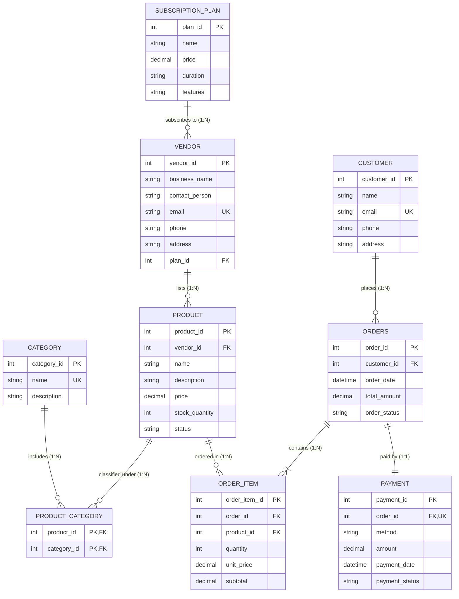

# Multi-Vendor SaaS E-Commerce Database Project

This repository contains the complete solution for the **Multi-Vendor SaaS E-Commerce Database Project**, including the Entity-Relationship Diagram (ERD), full SQL DDL schema definitions, DML operations, and analytical DQL queries.

---

## 📁 Project Contents
- **`ecommerce_saas.sql`**: The single complete SQL script containing all table creations (DDL), sample data setup, required data manipulations (DML), and query solutions (DQL). Every query is thoroughly documented with comments (`--`).
- **`erd_diagram.html`**: An interactive, standalone HTML visualizer of the complete Entity-Relationship Diagram (ERD) with tables, fields, primary/foreign keys, and cardinalities. Double-click to open in any web browser!
- **`README.md`**: Complete documentation covering all questions (Parts A, B, C, D) with explanations.

---

## Part A: ERD & Database Design

### 1. Entity-Relationship Diagram (ERD)



### Cardinality Summary
1. **SubscriptionPlan to Vendor (1:N)**: A subscription plan can be subscribed to by multiple vendors, but each vendor can only subscribe to one plan at a time.
2. **Vendor to Product (1:N)**: A vendor can list many products, but each product belongs to exactly one vendor.
3. **Product to Category (M:N)**: A product may appear in multiple categories, and each category can hold multiple products. Handled via the junction table `product_category`.
4. **Customer to Orders (1:N)**: A customer can place multiple orders over time.
5. **Orders to OrderItem (1:N)**: Each order consists of one or more ordered items.
6. **Product to OrderItem (1:N)**: A product can appear across multiple order line items.
7. **Orders to Payment (1:1)**: For every order placed, there is a corresponding payment record detailing payment method, status, and amount.

---

## Part B: SQL DDL (Table Creation)

### Question 3: Vendor Table Creation
```sql
CREATE TABLE vendor (
    vendor_id INT AUTO_INCREMENT PRIMARY KEY,
    business_name VARCHAR(150) NOT NULL,
    contact_person VARCHAR(100) NOT NULL,
    email VARCHAR(100) NOT NULL UNIQUE,
    phone VARCHAR(25) NOT NULL,
    address TEXT NOT NULL,
    plan_id INT NOT NULL,
    created_at TIMESTAMP DEFAULT CURRENT_TIMESTAMP,
    CONSTRAINT fk_vendor_subscription_plan 
        FOREIGN KEY (plan_id) REFERENCES subscription_plan(plan_id)
        ON UPDATE CASCADE
        ON DELETE RESTRICT
);
```

### Question 4: ProductCategory Table Creation (Handling M:N)
```sql
CREATE TABLE product_category (
    product_id INT NOT NULL,
    category_id INT NOT NULL,
    PRIMARY KEY (product_id, category_id),
    CONSTRAINT fk_pc_product 
        FOREIGN KEY (product_id) REFERENCES product(product_id)
        ON UPDATE CASCADE
        ON DELETE CASCADE,
    CONSTRAINT fk_pc_category 
        FOREIGN KEY (category_id) REFERENCES category(category_id)
        ON UPDATE CASCADE
        ON DELETE CASCADE
);
```

---

## Part C: SQL DML (Insert / Update / Delete)

### Question 5: Insert Vendor "SmartTech Ltd." under Basic plan
```sql
INSERT INTO vendor (business_name, contact_person, email, phone, address, plan_id)
SELECT 
    'SmartTech Ltd.', 
    'Rahim Khan', 
    'rahim@smarttech.com', 
    '01712345678', 
    'Dhaka, Bangladesh', 
    plan_id
FROM subscription_plan 
WHERE name = 'Basic';
```

### Question 6: Insert "Laptop" under Electronics category for SmartTech Ltd.
```sql
-- Step 1: Insert product
INSERT INTO product (vendor_id, name, description, price, stock_quantity, status)
SELECT 
    v.vendor_id,
    'Laptop',
    'High-performance laptop',
    75000.00,
    10,
    'active'
FROM vendor v
WHERE v.business_name = 'SmartTech Ltd.';

-- Step 2: Link to 'Electronics' category
INSERT INTO product_category (product_id, category_id)
SELECT 
    p.product_id,
    c.category_id
FROM product p
CROSS JOIN category c
WHERE p.name = 'Laptop' AND c.name = 'Electronics';
```

### Question 7: Update Stock Quantity of "Laptop" to 15
```sql
UPDATE product
SET stock_quantity = 15
WHERE name = 'Laptop';
```

### Question 8: Delete Customer with email "oldcustomer@gmail.com"
```sql
DELETE FROM customer
WHERE email = 'oldcustomer@gmail.com';
```

---

## Part D: SQL Queries (DQL)

### Question 9: All vendors with their subscription plan name and price
```sql
SELECT 
    v.vendor_id,
    v.business_name,
    v.contact_person,
    v.email,
    sp.name AS subscription_plan_name,
    sp.price AS subscription_plan_price
FROM vendor v
INNER JOIN subscription_plan sp ON v.plan_id = sp.plan_id
ORDER BY v.vendor_id ASC;
```

### Question 10: Products under "Electronics" (name, price, stock quantity)
```sql
SELECT 
    p.name AS product_name,
    p.price,
    p.stock_quantity
FROM product p
INNER JOIN product_category pc ON p.product_id = pc.product_id
INNER JOIN category c ON pc.category_id = c.category_id
WHERE c.name = 'Electronics';
```

### Question 11: Orders placed by "Karim Uddin" (order_id, date, total_amount, status)
```sql
SELECT 
    o.order_id,
    o.order_date,
    o.total_amount,
    o.order_status
FROM orders o
INNER JOIN customer c ON o.customer_id = c.customer_id
WHERE c.name = 'Karim Uddin'
ORDER BY o.order_date DESC;
```

### Question 12: Payment details for order_id = 1 (method, amount, status)
```sql
SELECT 
    method,
    amount,
    payment_status,
    payment_date
FROM payment
WHERE order_id = 1;
```

### Question 13: Top 5 best-selling products based on total quantity sold
```sql
SELECT 
    p.product_id,
    p.name AS product_name,
    SUM(oi.quantity) AS total_quantity_sold
FROM product p
INNER JOIN order_item oi ON p.product_id = oi.product_id
GROUP BY p.product_id, p.name
ORDER BY total_quantity_sold DESC
LIMIT 5;
